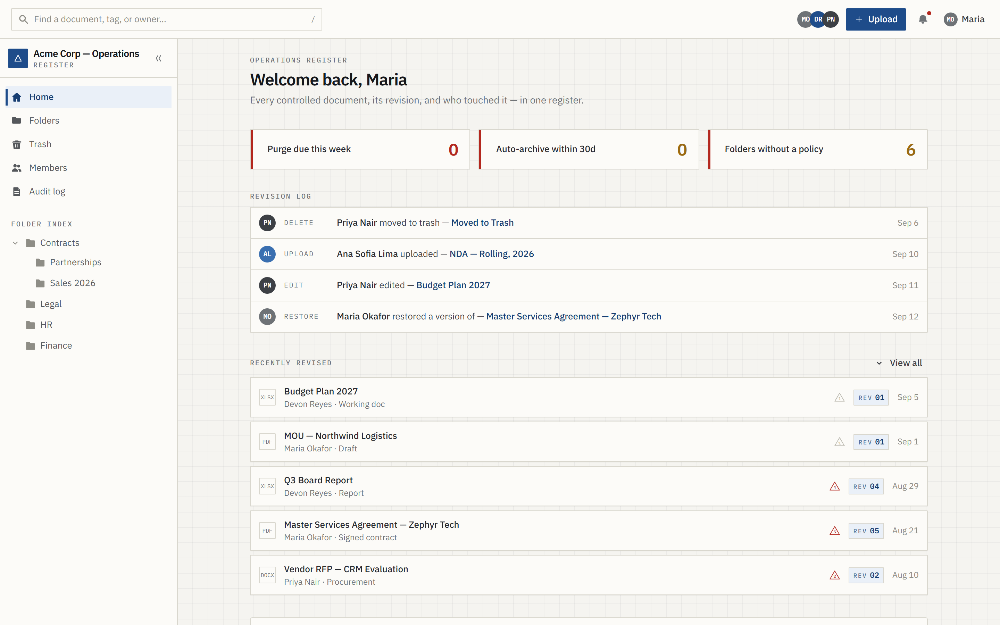
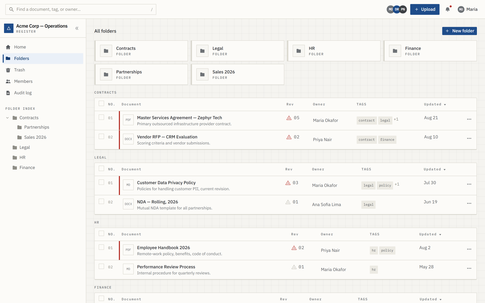
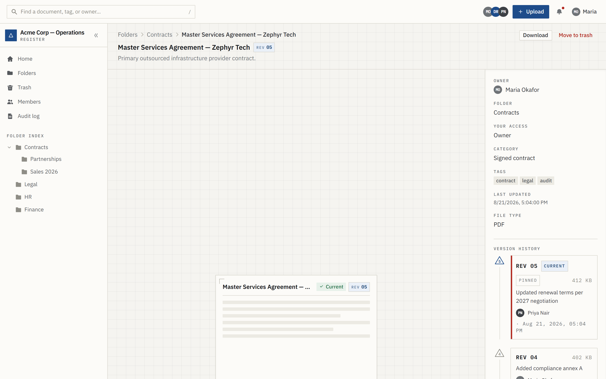
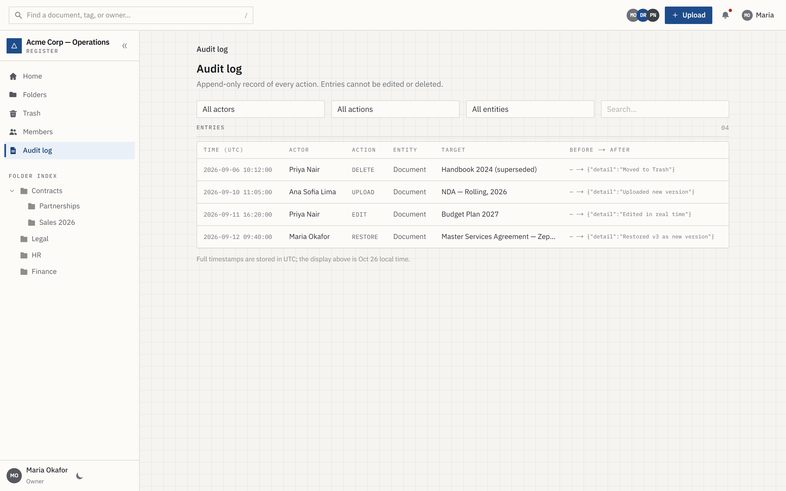
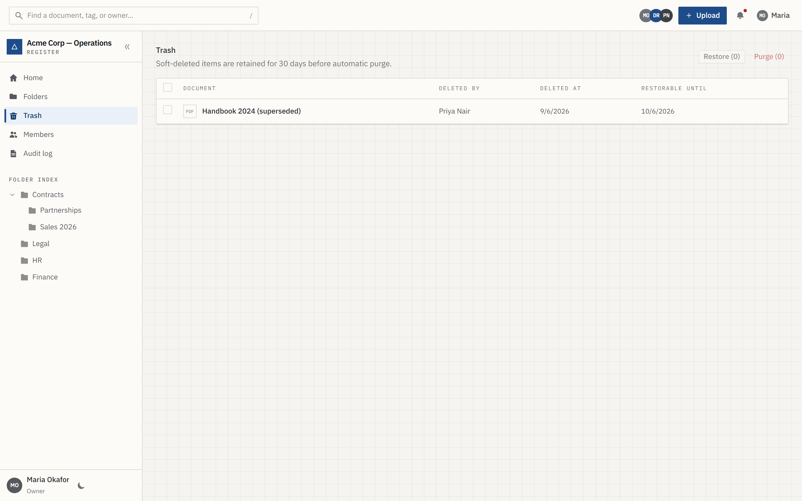

<div align="center">

# Relay DMS

**A document register with version history, folder-level access control, soft delete and an append-only audit trail.**




</div>

## Overview

Relay DMS is a Next.js 16 prototype of a document management system. Teams organise files into nested folders, every save becomes an immutable revision, deletions go to Trash before purge, and every action is written to an audit log.

Authentication is real: accounts live in SQLite, passwords are hashed with `scrypt`, and sessions are httpOnly cookies checked by `proxy.ts` on every request. Document content, versions and the audit trail are client-side (`localStorage`) so the prototype runs with no backend for the register itself.

## Features

- **Auth** — signup, login, logout, password reset; scrypt hashing, 7-day httpOnly sessions, timing-safe credential check.
- **RBAC** — `owner` / `editor` / `viewer` roles with per-folder overrides; every action is gated through a single `can(perm)` check.
- **Folders** — nested tree, create, per-folder governance panel.
- **Upload** — PDF, DOCX, XLSX, PNG, JPG, TXT, MD; title, description, tags, category.
- **Search** — title, description, tags, owner and folder, permission-filtered.
- **Version history** — monotonic revisions; restore copies forward as a new version, history is never rewritten.
- **Trash** — soft delete with deleted-by/at, restore or purge (owner only).
- **Audit log** — create, upload, edit, restore, delete, purge, retention and permission events, filterable.
- **Members** — owners change roles, written to both SQLite and the local store.
- **Dark mode** — system-aware, persisted per session.

> Retention policies can be configured per folder, but archive/purge is **not enforced** yet — `pastWindow()` in `lib/perms.ts` is only exercised by the check script.

## Screenshots

| | |
|---|---|
|  |  |
| **Folders** — tree, document table, bulk actions | **Document** — preview, metadata, immutable revision history |
|  |  |
| **Audit log** — every action, filterable | **Trash** — soft-deleted documents, restore or purge |

All screenshots are captured from the seeded demo data at 2x, 1440×900.

## Tech stack

| Layer | Choice |
|---|---|
| Framework | Next.js 16 (App Router, Turbopack, React Server + Client Components) |
| UI | React 19, Tailwind CSS 4, hand-rolled components (no UI library) |
| Auth | `node:sqlite` + `node:crypto` scrypt, httpOnly session cookies |
| State | `useSyncExternalStore` over a `localStorage`-backed store |
| Language | TypeScript 5 (strict) |
| Checks | `node:assert` scripts for permissions and auth, ESLint, `tsc --noEmit` |

## Quick start

Requires **Node.js ≥ 22.5** (`node:sqlite`).

```bash
npm install
npm run dev          # http://localhost:3000
```

Seeded accounts are created on first run. The demo password is shown on the sign-in page and defined in [`lib/auth.ts`](./lib/auth.ts).

| Command | What it does |
|---|---|
| `npm run dev` | Start the dev server |
| `npm run build` | Production build |
| `npm run start` | Serve the production build |
| `npm run lint` | ESLint |
| `npm run check` | Permission + auth assertion suites |

Optional environment:

| Variable | Default | Purpose |
|---|---|---|
| `DMS_DB_PATH` | `data/dms.db` | SQLite file path; use `:memory:` for throwaway runs |

## Demo accounts

| Person | Email | Role |
|---|---|---|
| Maria Okafor | `maria.okafor@acme.com` | Owner |
| Devon Reyes | `devon.reyes@acme.com` | Owner |
| Priya Nair | `priya.nair@acme.com` | Editor |
| Ana Sofia Lima | `ana.sofia.lima@acme.com` | Editor |
| Tom Beck | `tom.beck@acme.com` | Viewer |

Sign in as Maria to see members, audit log and purge actions.

## Routes

| Page | Purpose |
|---|---|
| `/` | Redirects to `/dashboard` |
| `/dashboard` | Recent activity, quick access |
| `/folders`, `/folders/[id]` | Folder tree, documents, ownership and retention panel |
| `/documents/[id]` | Preview, metadata, version history, restore, delete |
| `/search` | Metadata search with filters |
| `/trash` | Soft-deleted documents |
| `/audit` | Append-only audit log |
| `/settings/members` | Role management (owner only) |
| `/upload` | Upload and metadata form |
| `/login`, `/register`, `/reset-password` | Auth screens |

| API | Methods |
|---|---|
| `/api/auth/login` | `POST` |
| `/api/auth/register` | `POST` |
| `/api/auth/logout` | `POST` |
| `/api/auth/forgot` | `POST` |
| `/api/auth/reset` | `POST` |
| `/api/auth/me` | `GET` |
| `/api/users` | `GET` |
| `/api/users/[personId]/role` | `PATCH` |

## Project structure

```
app/
  (app)/          authenticated shell: dashboard, folders, documents, search, trash, upload, audit, members
  api/            auth + user route handlers
  login/ register/ reset-password/
components/
  dms/            document table, folder views, version list, preview, dropzone, governance
  shell/          sidebar, topbar, mobile nav
  ui/             button, chip, field, menu, notice, checkbox, avatar, breadcrumbs, empty state, skeleton
lib/
  auth.ts         SQLite connection, schema, seed, sessions, password reset
  store.ts        localStorage-backed document store + selectors
  perms.ts        role → permission table, folder overrides, retention window
  mock.ts         seeded people, folders, documents, versions
  redirect.ts     safe post-login redirect
scripts/          check-auth.mjs, check-perms.mjs
data/dms.db       SQLite database, created on first run
proxy.ts          auth gate (Next 16 proxy, Node runtime)
```

## How data works

- **SQLite** (`data/dms.db`) stores `users`, `sessions` and `resets`. Created and seeded automatically on first request.
- **localStorage** (`dms.store.v1`) stores folders, documents, versions, memberships, folder role overrides, retention policies and the audit log. Seeded from `lib/mock.ts` on first load, so each browser has its own register.
- Deleting the browser key resets the register; deleting `data/dms.db` resets accounts.

This split is deliberate for the prototype: real auth, no backend for content. Moving the register to SQLite is the next step before multi-user use.

## Docs

- [`PRD.md`](./PRD.md) — problem, personas, functional requirements
- [`PRODUCT.md`](./PRODUCT.md) — positioning, users, constraints
- [`DESIGN.md`](./DESIGN.md) — visual thesis, tokens, accessibility

---

Prototype, not production software. No license file included.
